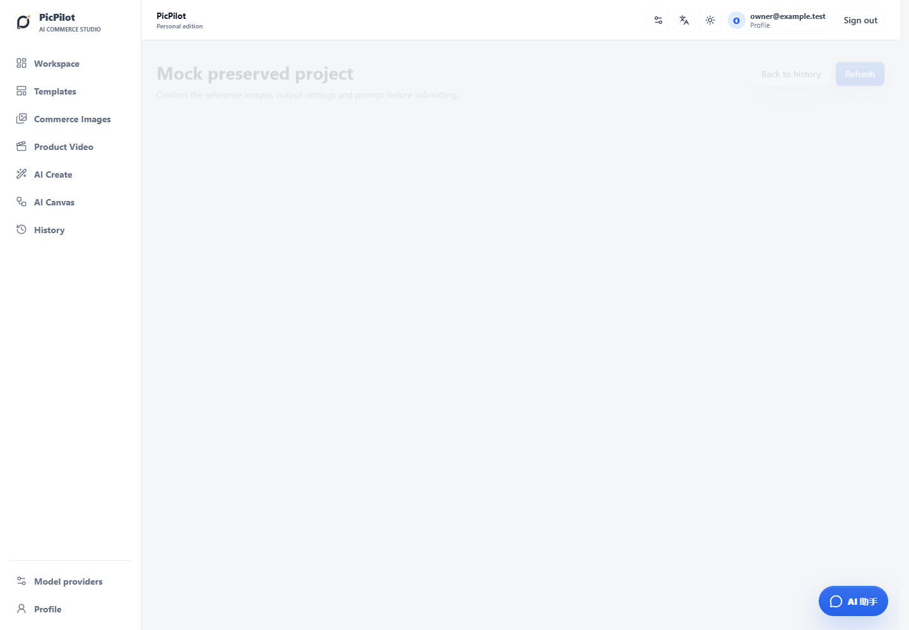
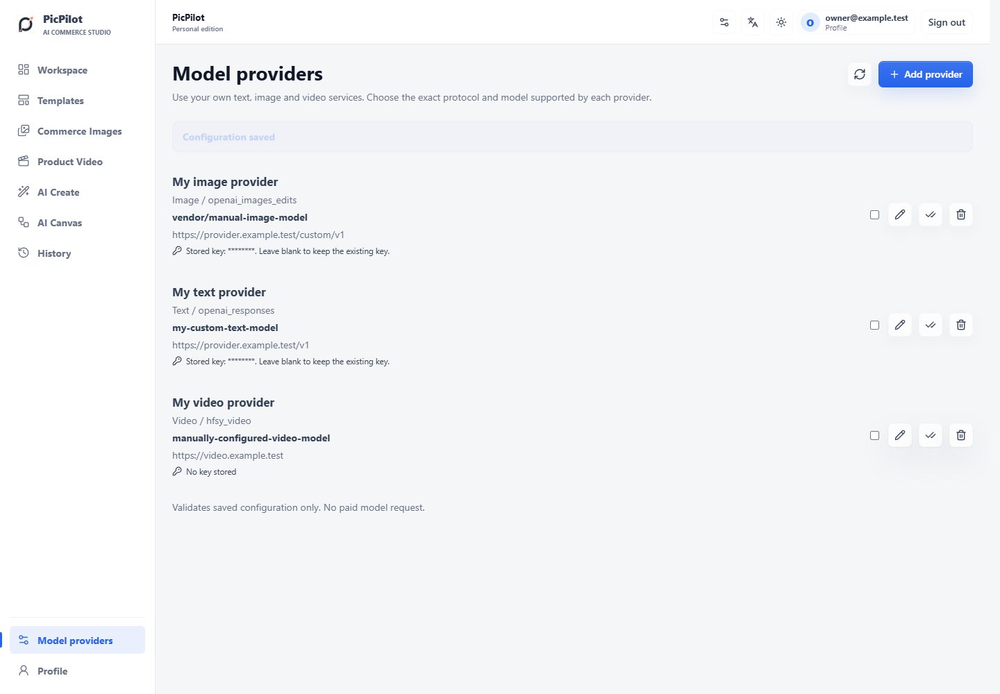
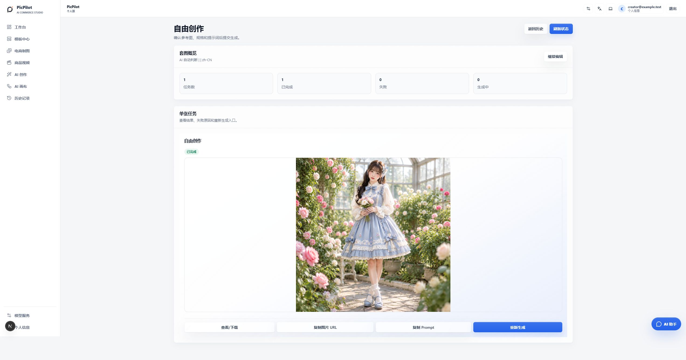

# PicPilot Personal

[简体中文](README.md) | [English](README.en.md) | [日本語](README.ja.md)

Self-hosted, creator-first PicPilot for image-making and visual content work. Connect your own image, text and video providers in Settings, then explore ideas with reference images, the workbench, creative studio and infinite canvas. Go handles the business backend; React/Next.js handles the frontend. There is no platform billing, credit storefront or administrator website.

**Public migration acceptance build, not yet declared production-ready.** Do not connect a Java production database. This edition has its own schema and does not automatically import platform users or payment records.

## Quick Start

Install Git, a running Docker Engine / Docker Desktop, and Docker Compose v2. The first build downloads container images and dependencies. Recommended available resources: 4 CPU cores, 8 GB RAM and 10 GB disk space.

```sh
git clone https://github.com/suakitsu/picpilot-personal.git
cd picpilot-personal
```

The repository is public; cloning does not require a GitHub token.

Windows PowerShell:

```powershell
./scripts/init.ps1
docker compose up -d --build
docker compose ps
docker compose exec api /picpilot --setup-token
```

Linux / macOS:

```sh
sh scripts/init.sh
docker compose up -d --build
docker compose ps
docker compose exec api /picpilot --setup-token
```

1. Open [PicPilot](http://localhost:8080). Use the setup token displayed in your terminal to create your account. Keep that token private.
2. Sign in and open model settings. Add a provider with its actual compatible protocol, model ID, service URL and your API key.
3. Validate and explicitly enable the configuration. Configuration checks do not invoke paid models. Actual generation can incur charges from your upstream provider.

There are no default accounts, passwords or paid credentials. The initializer generates a random database password; the application generates independent persistent encryption keys. Personal tasks never borrow another user's or an operator's credentials and do not deduct platform credits.

The repository includes its complete `core` source snapshot. **No platform checkout or private module download is needed.** Public registration is disabled; the administrator website is not deployed. Next.js only renders pages and proxies transport. Go owns jobs, business data and provider execution.

## Cold-start acceptance

A new user needs only this repository and Docker; Go, Node and PostgreSQL do not need to be installed on the host:

```powershell
./scripts/init.ps1                 # first run only: writes .env and a random DB password
docker compose up -d --build       # builds the Go API, user site and gateway
docker compose ps                   # wait for db/api/user/gateway to be running/healthy
docker compose exec api /picpilot --setup-token
```

The setup token is printed once. Open `http://localhost:8080` and use it to create your personal
account. Startup is complete when the home/login page is visible and the API has passed its Compose
health check. On Linux/macOS use `sh scripts/init.sh` for the first command. The first build downloads
images and dependencies; later starts use `docker compose start` without rebuilding.

The isolated empty-database acceptance run covered image builds, migrations, first account creation,
login, encrypted personal provider storage, mock image/text jobs, idempotency, signed media and logout.
These screenshots are local browser acceptance evidence; they contain no customer data and do not call
a paid model.

The following are previously captured 1440px desktop browser pages, not mobile viewports or narrow cropped images:





### Live provider showcase (2026-10-30)

In an isolated local data directory, the personal user configured the OpenAI Images-compatible Sualoom provider (`gpt-image-2`) and used it to generate a real 1K square adult Lolita fashion portrait. The screenshot below is the successful product-detail page from that request and is separate from the Mock acceptance screenshots above. This is not part of the default test path; the upstream service may charge according to its own policy.



Troubleshooting:

- Missing `POSTGRES_PASSWORD`: run `init.ps1`/`init.sh`; never put real credentials in `.env.example`.
- Docker Engine unavailable: start Docker Desktop and confirm `docker info` returns Server data.
- Port conflict: change `PICPILOT_HTTP_PORT` and `PICPILOT_PUBLIC_URL` together in `.env`.
- Page unavailable: inspect `docker compose ps` and `docker compose logs --tail=100 api gateway`; do not
  delete volumes first.
- Use `docker compose stop` for routine shutdown and `docker compose start` to resume. `down -v` deletes
  the database and application data. See [operations](docs/operations.md) for backup, restore, upgrade
  and rollback procedures, and [testing](docs/testing.md) for the safety boundary.

## Providers and Local Gateways

Configured adapters cover OpenAI images and Gemini images; OpenAI Chat Completions / Responses for text; APIMart, HFSY and Agnes for video. Choose a protocol compatible with your actual upstream API. A provider's name alone does not establish compatibility.

With the default localhost `PICPILOT_PUBLIC_URL`, trusted local gateways such as `http://127.0.0.1:8888/v1` are enabled automatically. Inside a container, `127.0.0.1` refers to that container, not your computer; Docker Desktop can reach a host gateway using `host.docker.internal`. Set `PICPILOT_ALLOW_PRIVATE_PROVIDERS=false` for a public deployment and never expose an unauthenticated local gateway. See [configuration](docs/configuration.md).

## Data and Operations

- HTTP binds only to `127.0.0.1:8080`; PostgreSQL has no published host port. Use HTTPS for public access.
- Provider keys are encrypted server-side and are never returned to browsers or embedded canvases.
- Back up `.env`, the database, uploaded files and `instance-secrets.json` together. Losing the encryption key makes saved provider credentials unreadable.
- Do not stop the system with `docker compose down -v`: that deletes persistent volumes.

```sh
docker compose stop
docker compose start
docker compose logs --tail=100 api
```

[Configuration and HTTPS](docs/configuration.md) · [Backup, restore and upgrades](docs/operations.md) · [Tests](docs/testing.md)

## Acknowledgements

PicPilot thanks the following open-source projects for the canvas capabilities. The personal edition
retains their licenses, corresponding source and provenance notes while adding PicPilot branding,
authentication, task bridging and personal storage:

- [Nova Image Studio](https://github.com/tianjiangqiji/nova-image-studio): creative studio,
  version `3.1.3`, pinned commit `7768f3f8d7f47e04c6d18572837a086c7a533161`, AGPL-3.0.
- [Infinite Canvas](https://github.com/basketikun/infinite-canvas): infinite canvas,
  pinned commit `705fdd9b2f7bfe6fd58156fd5c1cdb1ad251c767`, GNU AGPL v3.

License, provenance and modification notes are in
`third_party/nova-image-studio/UPSTREAM.md` and `third_party/infinite-canvas/PROVENANCE.txt`.

## Editions and License

For multi-user operations, payments and administration, use the separate `suakitsu/picpilot-platform` repository. The original Java platform remains independent and unchanged.

PicPilot's original code owned by suakitsu is available under [MIT](LICENSE). The bundled third-party canvases and Nova data in `core/nova/defaults/` retain AGPL-3.0. The combined application is distributed under AGPL-3.0 and is not MIT-only. See [Licensing](LICENSING.md) for scope, third-party notices and corresponding-source obligations.
